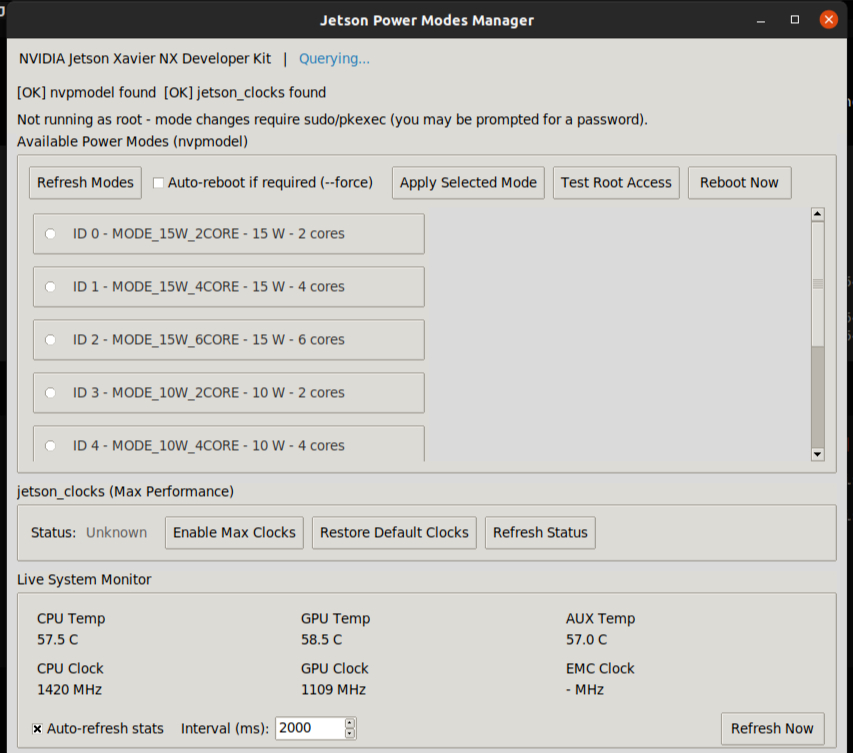

# Jetson Power Modes Manager GUI

A professional Tkinter-based desktop application for managing power modes on NVIDIA Jetson boards using the inbuilt `nvpmodel` and `jetson_clocks` CLI tools.

[](https://www.python.org/)
[](https://developer.nvidia.com/embedded/linux)
[](LICENSE)

---

## Screenshot



*Jetson Power Modes Manager running on Jetson Xavier NX*

The application displays:
- **Header**: Board model name and current active power mode
- **Power Modes Panel**: Scrollable list of all modes (ID, name, watts, cores) with active mode highlighted
- **jetson_clocks Panel**: Enable/Restore max performance clocks
- **Live System Monitor**: CPU/GPU/AUX temperatures and CPU/GPU/EMC frequencies
- **Activity Log**: Timestamped console of all actions
- **Status Bar**: Current operation status

---

## Supported Boards

The application is **board-agnostic** and dynamically reads power modes from `/etc/nvpmodel.conf`, making it compatible with any Jetson board that includes `nvpmodel` and `jetson_clocks`.

| Board Series | JetPack | nvpmodel | jetson_clocks | Status |
|--------------|---------|----------|---------------|--------|
| Jetson Xavier NX | 4.x, 5.x, 6.x | ✅ | ✅ | Tested |
| Jetson AGX Xavier | 4.x, 5.x | ✅ | ✅ | Supported |
| Jetson Orin Nano | 5.x, 6.x | ✅ | ✅ | Supported |
| Jetson Orin NX | 5.x, 6.x | ✅ | ✅ | Supported |
| Jetson AGX Orin | 5.x, 6.x | ✅ | ✅ | Supported |
| Jetson Thor | 6.x, 7.x | ⚠️ | ⚠️ | Best-effort |

> ⚠️ Jetson Thor support depends on JetPack including `nvpmodel` and `jetson_clocks`. The app includes a startup compatibility check that warns if tools are missing.

---

## Features

| Category | Feature |
|----------|---------|
| **Power Modes** | Dynamically lists all available modes from `/etc/nvpmodel.conf` (ID, name, wattage, core count) |
| **Mode Switching** | Switch power modes with `nvpmodel -m <id>` using `pkexec`/`sudo` elevation |
| **Auto-Reboot** | Optional `--force` flag with 10-second countdown dialog for automatic reboot |
| **Manual Reboot** | One-click "Reboot Now" button with confirmation dialog |
| **jetson_clocks** | Enable max CPU/GPU/EMC clocks or restore to power-mode defaults |
| **Live Monitor** | Real-time CPU/GPU/AUX temperatures and CPU/GPU/EMC frequencies |
| **Auto-Refresh** | Configurable refresh interval (500ms – 60s) |
| **Root Check** | Verify `sudo`/`pkexec` access before making changes |
| **Activity Log** | Console log of all actions with timestamps |
| **Desktop Integration** | Application menu entry, system icons, window titlebar icon |

---

## Requirements

- **Hardware**: NVIDIA Jetson board (Xavier NX, AGX Xavier, Orin series, Thor)
- **OS**: JetPack / L4T (Jetson Linux)
- **Python**: 3.6+ with `tkinter` (`python3-tk` package)
- **Tools**: `nvpmodel`, `jetson_clocks` (included in L4T)
- **Privileges**: `sudo` or `pkexec` access for mode changes and `jetson_clocks`

---

## Installation

### From Source

```bash
# Clone or navigate to the project directory
cd /home/charith/jetsonpower-gui

# Install system-wide (requires root)
sudo make install
```

The `make install` target will:

1. Install the application to `/usr/share/jetson-power-gui/`
2. Install the launcher to `/usr/bin/jetson-power-gui`
3. Install the desktop entry to `/usr/share/applications/`
4. Install icons to `/usr/share/icons/hicolor/*/apps/`
5. Update the icon cache (via `gtk-update-icon-cache`)
6. Update the desktop database (via `update-desktop-database`)

### Launch

After installation, you can launch the application in two ways:

**From the application menu:**
- Look for **Jetson Power Modes Manager** under Settings / System

**From the terminal:**
```bash
jetson-power-gui
```

**From source (without installation):**
```bash
cd /home/charith/jetsonpower-gui
python3 jetson_power_gui.py
```

---

## Uninstallation

```bash
cd /home/charith/jetsonpower-gui
sudo make uninstall
```

This removes:
- `/usr/bin/jetson-power-gui`
- `/usr/share/jetson-power-gui/jetson_power_gui.py`
- `/usr/share/applications/jetson-power-gui.desktop`
- All icon files from `/usr/share/icons/hicolor/*/apps/`
- Refreshes icon cache and desktop database

---

## Usage

### Switching Power Modes

1. Launch the application
2. Select a power mode from the list (the active mode is highlighted with `*`)
3. Optionally check **Auto-reboot if required (--force)** if the mode change requires a reboot
4. Click **Apply Selected Mode**
5. Confirm the action in the dialog
6. If auto-reboot is enabled, a 10-second countdown appears before the board reboots

### Using jetson_clocks

- **Enable Max Clocks**: Sets static maximum frequency for CPU, GPU, and EMC
- **Restore Default Clocks**: Reverts to power-mode default clock settings
- **Refresh Status**: Checks whether max clocks are currently active

### Monitoring System Stats

The Live System Monitor panel displays:
- **CPU Temp** — from thermal zone `CPU-therm`
- **GPU Temp** — from thermal zone `GPU-therm`
- **AUX Temp** — from thermal zone `AUX-therm` / `SOC-therm`
- **CPU Clock** — current CPU frequency in MHz
- **GPU Clock** — current GPU frequency in MHz
- **EMC Clock** — current EMC frequency in MHz

Enable **Auto-refresh stats** and set the interval (500ms – 60s) for automatic updates.

---

## Makefile Targets

| Target | Description |
|--------|-------------|
| `make install` | Install system-wide (requires root) |
| `make uninstall` | Remove system-wide installation |
| `make clean` | Show cleanup info (pure Python, no build artifacts) |
| `make help` | Display available targets |

---

## Testing

A comprehensive test suite is included (22 tests, no display required):

```bash
cd /home/charith/jetsonpower-gui
python3 test_jetson_power_gui.py -v
```

Tests cover:
- Board detection (Xavier NX, AGX Xavier, Orin Nano)
- Power mode parsing (Xavier NX, Orin configurations)
- Current mode query (`nvpmodel -q` output parsing)
- Thermal zone reading
- CPU/GPU/EMC frequency unit detection (Hz, kHz, MHz)
- CLI tool availability
- Command execution (success/failure)

---

## File Structure

```
jetsonpower-gui/
├── jetson_power_gui.py      # Main application
├── test_jetson_power_gui.py # Test suite (22 tests)
├── jetson-power-gui         # Launcher script
├── jetson-power-gui.desktop # Desktop entry
├── Makefile                 # Build/install/uninstall
├── icons/
│   ├── 16x16/jetson-power-gui.png
│   ├── 32x32/jetson-power-gui.png
│   ├── 48x48/jetson-power-gui.png
│   ├── 64x64/jetson-power-gui.png
│   ├── 128x128/jetson-power-gui.png
│   ├── 256x256/jetson-power-gui.png
│   └── 512x512/jetson-power-gui.png
└── README.md
```

---

## Troubleshooting

| Issue | Solution |
|-------|----------|
| **Icons not showing in app menu** | Run `sudo gtk-update-icon-cache -f /usr/share/icons/hicolor` and `sudo update-desktop-database` |
| **X11 BadLength / RenderAddGlyphs error** | Ensure no special Unicode characters are in labels (fixed in v1.1+) |
| **Mode switch fails** | Check that `nvpmodel` is installed and you have `sudo`/`pkexec` access. Click **Test Root Access** |
| **jetson_clocks not found** | The tool may not be included in your JetPack version. Clock controls will be disabled |
| **No power modes listed** | Your board may not use `/etc/nvpmodel.conf`. Check if `nvpmodel -q` works manually |
| **GUI font errors** | The app uses Tk default fonts; ensure `python3-tk` is installed: `sudo apt install python3-tk` |

---

## License

MIT License. See [LICENSE](LICENSE) for details.

---

## Contributing

1. Fork the repository
2. Create a feature branch (`git checkout -b feature/improvement`)
3. Commit your changes (`git commit -am 'Add improvement'`)
4. Push to the branch (`git push origin feature/improvement`)
5. Open a Pull Request

---

## Author

Jetson Power Modes Manager — Professional power management GUI for NVIDIA Jetson boards.

---

> **Note**: Changing power modes affects system performance and may require a reboot. Always save your work before switching modes or rebooting.